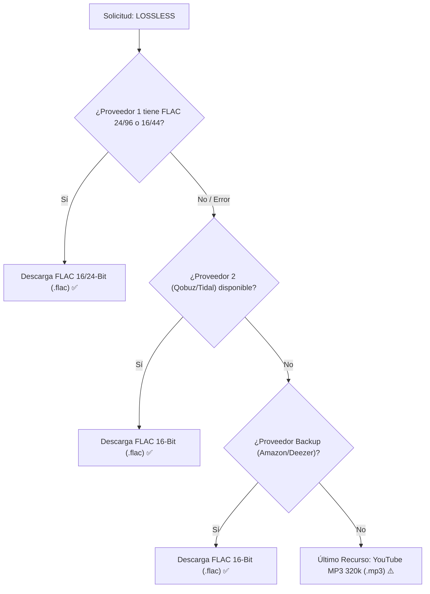

# 🎚️ Guía de Calidades de Audio, Formatos y Fallbacks en SpotiFLAC Extended

SpotiFLAC Extended admite múltiples niveles de calidad de audio de alta fidelidad (Studio Master Hi-Res, CD Lossless sin pérdida, Dolby Atmos y comprimidos de alta velocidad).

Esta guía explica en detalle cómo solicitar cada calidad en la API, qué formatos de archivo se generan y cómo funciona la cascada de seguridad (*fallback*).

---

## 📊 Matriz de Calidades de Audio

| Parámetro API (`quality`) | Formato / Contenedor | Profundidad de Bits | Tasa de Muestreo (Sample Rate) | Tasa de Bits (Bitrate) | Descripción |
| :--- | :--- | :--- | :--- | :--- | :--- |
| **`HI_RES_LOSSLESS`** | `.flac` | 24-Bit | 96 kHz – 192 kHz | ~3000 – 9216 kbps | **Mastering de Estudio Máximo**. La calidad de audio más alta disponible comercialmente. |
| **`HI_RES`** | `.flac` | 24-Bit | 44.1 kHz – 96 kHz | ~2000 – 4608 kbps | **Audio de Alta Resolución (24-bit)**. Ideal para audiófilos y equipos DAC de alta gama. |
| **`LOSSLESS`** *(Recomendado)* | `.flac` | 16-Bit | 44.1 kHz | 1411 kbps | **Calidad CD Nativa (Sin Pérdida)**. FLAC 16-bit estándar, relación perfecta tamaño/calidad. |
| **`HIGH`** | `.mp3` / `.m4a` | 16-Bit | 44.1 kHz | 320 kbps | **Audio Comprimido de Alta Calidad**. AAC/MP3 a 320 kbps para ahorrar espacio o datos. |
| **`LOW`** | `.mp3` | 16-Bit | 44.1 kHz | 128 kbps | **Modo Ahorro de Datos**. Descarga rápida para conexiones lentas o pruebas. |
| **`DOLBY_ATMOS`** | `.m4a` (Spatial) | 16-Bit | 48 kHz | Variable (E-AC3 / Spatial) | **Audio Espacial 3D (Dolby Atmos)**. Extraído de servicios compatibles (ej. Tidal). |

---

## ⚙️ ¿Cómo Funciona la Cascada de Calidad (*Fallback Chain*)?

Cuando solicitas una calidad específica en `POST /api/v1/downloads`, SpotiFLAC ejecuta una **cascada de degradación elegante** para garantizar que la descarga nunca falle silenciosamente ni devuelva errores innecesarios.

### 🔄 Ejemplo: Solicitud con `quality: "LOSSLESS"`



1. **Intento 1 (`HI_RES_LOSSLESS` / `LOSSLESS`)**:
   Consulta las APIs Hi-Res para obtener FLAC 24-bit / 16-bit.
2. **Intento 2 (`LOSSLESS` CD Quality)**:
   Si Hi-Res no existe para esa canción específica, busca el stream Lossless 16-bit (CD Quality 1411 kbps).
3. **Intento 3 (Fallback Secundario)**:
   Cambia al siguiente proveedor de la lista (ejemplo: si `ext:tidal-web` falla, conmuta automáticamente a `ext:qobuz-web`, luego `amazon`, luego `deezer`).
4. **Intento 4 (Último Recurso - YouTube)**:
   Si **todos** los proveedores audiófilos fallan o el contenido es un remix/indie no oficial, recurre a YouTube entregando MP3 a 320 kbps.

---

## 📝 Ejemplos de Payload JSON para la API REST

### 1. Solicitud Estándar Lossless (FLAC 16/44.1kHz - Recomendado para la mayoría)
```json
{
  "url": "https://open.spotify.com/track/0m2UVJS2dZjXtbi0tB2A0t",
  "quality": "LOSSLESS",
  "services": ["ext:tidal-web", "ext:qobuz-web", "amazon", "qobuz", "deezer", "youtube"],
  "embed_lyrics": true,
  "enrich_metadata": true
}
```

### 2. Solicitud Ultra Hi-Res (FLAC 24-Bit / 192kHz)
```json
{
  "url": "https://open.spotify.com/track/0m2UVJS2dZjXtbi0tB2A0t",
  "quality": "HI_RES_LOSSLESS",
  "services": ["ext:qobuz-web", "qobuz", "ext:tidal-web", "amazon"],
  "embed_lyrics": true,
  "enrich_metadata": true
}
```

### 3. Solicitud Dolby Atmos (Audio Espacial 3D)
```json
{
  "url": "https://open.spotify.com/track/0m2UVJS2dZjXtbi0tB2A0t",
  "quality": "DOLBY_ATMOS",
  "services": ["ext:tidal-web", "tidal"],
  "embed_lyrics": true
}
```
